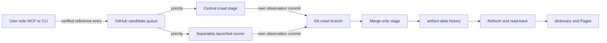

# Issue #84: Git-backed candidate and crawl lifecycle

Status: revised design for user review. The deployed implementation and its
2026-10-21 smoke test follow a different lifecycle. They must not be used as
evidence that this design has been implemented or that #84 can close.

## Three distinct roles

MCP and CLI run on the **user side**. They may fetch and verify current public
package information for the user's immediate answer. They submit a **reference
entry** so that the shared crawlers check this package first. Their result is
not itself an update to the Git-recorded crawl data or the public dictionary.
No Git write permission for the user-side process is assumed.

The central collection workflow and runners launched separately by the user
are peers as **crawl producers**. Both select reference entries ahead of
ordinary crawl work, fetch official registry metadata and bounded release
artifacts themselves, and record only their own resulting crawl observations
in Git. Neither producer treats an MCP/CLI result as authoritative shared
data. They have the same authority to produce crawl history.

The **merge stage** has a narrower job: it merges crawl observation commits
into `artifact-data` history. It does not access a registry, repeat a package
check, choose a release, rewrite a current claim, or decide whether the
user-side entry was true. The central workflow may contain both a crawl
stage and a merge stage; saying that the merge stage only makes merge commits
does not prevent its crawl stage from checking packages. The normal refresh
later derives a view from merged history and publishes `dictionary` and Pages.

GitHub stores the queue, observation branches, merge history, publication
state, and workflow results. There is no separately hosted intake API or
database. GitHub Actions' repository-scoped token does not imply a
branch-specific ACL. The role boundary is about which result can update the
shared crawl history, not about treating MCP/CLI as a privileged runner.

## User-side reference entries

MCP/CLI returns its verified result to the user immediately, with the
registry/artifact source, acquisition time, digest, target, and unresolved
conditions. It also attempts to submit a small candidate entry containing
the canonical ecosystem/package, optional version and target, evidence
references, user-side checked time, and candidate ID. A completed submission
means only that GitHub durably holds a **priority hint**. It does not mean
that a crawler has checked the package, that a crawl observation was merged,
or that the dictionary is updated. If submission fails, the live result stays
usable and the submission status reports that failure explicitly.

Candidate entries are immutable and deduplicated by package, selector,
target, and evidence identity. Repeated hints for the same work can be
coalesced for scheduling, but a later hint must not be mistaken for a new
official crawl observation. The queue must be bounded and fair: pending
candidates run before routine work, while a sustained stream cannot starve
periodic rechecks of already published claims. A candidate is considered
handled only when a crawl result in Git references its ID; a temporary
registry error leaves it eligible for a later runner retry.

The **submission transport and authentication remain a review decision**.
The implementation must persist candidates in GitHub without embedding a
repository credential in a public MCP/CLI package or presuming that every
user can push to the repository. A GitHub-native workflow may write a
candidate branch after receiving an authenticated request, but this is not a
new independently hosted API. Until the authenticated ingress is defined,
MCP/CLI may return a verified reference entry but must not report it queued.

## Crawl observations from equal-authority producers

Both the central crawl stage and separately launched runners use the same
package discovery engine and outcome contract. For a selected candidate,
the producer **reacquires** official metadata and the exact bounded artifact;
it does not import the client's commands or digest as the crawl result. The
candidate ID is provenance and priority only. Scheduled producer runs also
recheck aged active claims, so withdrawal, changed entry points, and
reappearance are observed without another user-side request.

A successful producer writes one immutable `crawl/<event-id>` branch from the
`artifact-data` head it read before the acquisition. Its single event file
contains the producer's outcome, official evidence, checked time, source
identity, selector, target, and any triggering candidate IDs. The event ID
includes the actual crawl acquisition time: observing the same artifact again
must create fresh evidence rather than be absorbed as a duplicate. Creating
the ref with an empty expected-ref lease and reading it back prevents one
producer from overwriting another's branch. An unavailable Git remote leaves
the observation uncommitted and visibly failed, rather than falsely queued.

Only authoritative outcomes can alter the source view. Verified installed
entry points add or refresh a provider. Proven package absence or proven
absence of installed commands can withdraw the on-demand provider. Ambiguous
metadata, timeout, 429, or 5xx must not become a withdrawal. Exact-release
observations are history; a complete target-neutral `latest` crawl can
affect the current view. A successful entry-point check alone never proves
the target-specific install-and-invoke status required by #83.

## Merge, materialization, and recovery

The merge stage scans bounded `crawl/*` refs. It checks mechanical Git shape:
one commit, a parent in `artifact-data` history, and one correctly named,
size-bounded event file. It skips a tip already reachable from
`artifact-data`; otherwise it makes a no-fast-forward merge commit so the
producer's observation remains a parent in Git history. On a non-fast-forward
push, it fetches the new head and repeats the same merge. Unexpected branch
shapes or tree conflicts stay unmerged and visible for repair. The merge
stage does not requery public sites or adjudicate the content. Ref deletion
is not required for correctness; a later cleanup may remove only a known
merged SHA with a ref lease.

The refresh derives the current on-demand projection from merged crawl
events. A delayed old event cannot rewind a causally later event. Two
incompatible concurrent latest observations cannot be ordered merely by
merge order or client timestamps: the prior unambiguous public provider is
retained as stale/unresolved and a producer rechecks from a head containing
both events. Other sources and same-name providers are unaffected. The
review must settle this conflict rule before the fold is implemented.

The refresh publishes through the normal dictionary pipeline. It records a
selected event digest for each active or withdrawn claim and marks publication
`indexed(snapshot)` only after reading back the matching dictionary provider,
or its absence after an authoritative withdrawal. A merged crawl event is
durable even if refresh or Pages fails; the next refresh can retry. Candidate
status, crawl event reachability, and indexed publication are separate facts.

## Required migration and tests

The current code mixes these roles. User-side MCP/CLI discovery calls the Git
intake writer as if its result were a crawl observation. The collector
recontacts registries and sweeps claims. The existing intake ID omits the
acquisition time and would swallow repeated observations of unchanged
artifacts. The claim projection is not yet derived solely from merged crawl
events. Merely removing a network call from the collector would break
freshness and withdrawal handling.

Implementation must separate the candidate queue from producer crawl event
branches, move all official shared-data checks to the central crawl stage and
separately launched runners, make merging history-only, and migrate the
previously indexed provider without losing it. Tests must cover a user-side
result whose candidate is later disproved by a producer; priority ahead of
routine work without starvation; equal-authority producers and concurrent
branches; duplicate and lost-ACK Git operations; repeated same-artifact
checks; temporary failure versus authoritative withdrawal; concurrent latest
conflict and a resolving recheck; non-fast-forward merge; failed publication
and matching dictionary read-back. A new production MCP/CLI candidate →
central or separate runner crawl → Git merge → dictionary/Pages smoke test is
required before #84 closes.
