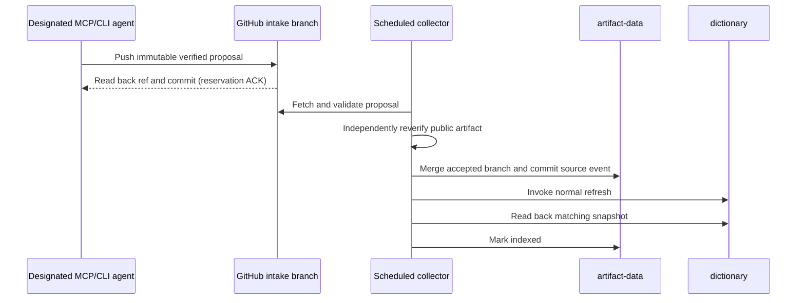

# Issue #84: Git-branch-based distributed discovery lifecycle

Status: design approved; implementation in progress, not deployed. The designated runner and its agent
do the live work; GitHub branches and commits hold every shared state. There
is no separate intake API, database, or human package-submission flow.

## System boundary

`main` contains code and workflows. `artifact-data` is the durable source and
publication ledger. `dictionary` is a generated snapshot, never an agent's
direct write target. A designated runner starts the MCP/CLI agent with Git
push rights to a restricted `intake/` branch namespace. A scheduled GitHub
Actions collector has rights to update `artifact-data`. The agent need not
hold permission to push `artifact-data`; branch rules should enforce this
split, and the real runner's permission must be checked before deployment.

An MCP/CLI operation on that runner verifies a **known published package**
from authoritative registry metadata and a bounded exact release artifact.
The live answer includes source URLs, artifact digest, checked time, command
declaration, target constraints, and unresolved conditions. A command-only
reverse search still uses the partial published dictionary. A successful live
verification starts a Git reservation automatically, but the live answer is
not a dictionary snapshot or a #83 install-and-invoke result.

Only the designated, Git-authorized runner can promise automatic reservation.
If a copy of the CLI/MCP server has no Git write authority, it can still return
live verification but reports `reservation.status=unavailable`. It cannot
claim that shared publication was scheduled. Offline mode has the same clear
separation. No credential is embedded in the Python package or MCP result.

## Branch is the reservation

For a verified release, the agent derives a deterministic ID from ecosystem,
canonical package ID, exact selected release, target variant, verifier
contract version, and artifact digest. It creates `intake/<id>` from the
current `artifact-data` head and commits exactly one immutable proposal file
at `data/production/on-demand/intake/<id>.json`. The proposal records the
source evidence references and whether the caller requested `latest` or an
exact version. It does not contain executable code or an already-authoritative
dictionary row. It is a request for the collector to check a claim, not a
trusted source observation.

The agent pushes the branch with an empty expected-ref lease, which permits only
creation and never updates an existing branch, then fetches the ref to confirm its
commit before returning a reservation ID. If another agent created the branch
first, the loser fetches it and compares the claim identity and artifact
digest. Different acquisition times for the same evidence coalesce; the
first proposal's time remains in the immutable commit. A different identity
or evidence digest at the same name is an integrity conflict, not an occasion
to replace the winner. A push that succeeded while its response was lost is
recovered by this read-back. Git operations are non-interactive, time-bounded,
and have a bounded conflict retry; a credential prompt must not block a query.

Distinct proposals use distinct branches. Agents never need to merge each
other's work or contend on one shared queue file. GitHub's ref and commit
history are the durable queue. The collector enumerates `intake/*` refs in
bounded batches. A branch stays pending through temporary failures, so an
Actions delay or crash does not erase the request. The collector maintains an
accepted/rejected ID ledger on `artifact-data`; the client checks that ledger
before creating a branch, and the collector checks it again before work. This
also deduplicates a repeated query after a processed branch is deleted.

## Collector: validate, merge, or reject

One Actions concurrency group serializes scheduled collector runs. A run
fetches the latest `artifact-data` head and a bounded set of intake refs.
It validates each branch before using it: its merge base must be an expected
`artifact-data` ancestor; its tree delta may contain only the one correctly
named proposal file; the JSON must match the branch ID, package identity,
target, verifier, and digest constraints. A malformed or unexpected branch
cannot alter the dictionary or run code. Its candidate SHA and rejection
reason are recorded on `artifact-data` before the ref is removed.

For a valid proposal, the collector independently reacquires official release
metadata and its exact artifact. Client evidence is useful for comparison but
never substitutes for this recheck. A timeout, 429, 5xx, or unverifiable
artifact leaves the branch pending with a retry record and next-attempt time
on `artifact-data`. An authoritative 404/410, withdrawal, changed artifact,
or superseded current release gets an explicit outcome; it is never inferred
from omission. A separate bounded sweep rechecks active current claims even
without new intake branches so later withdrawals can be observed.

After successful revalidation, the collector merges the proposal branch into
the latest `artifact-data` head and writes the source-owned observation event,
current claim/projection update, and `refresh_pending` ledger entry in the
same merge commit. A merge conflict is handled by meaning, not by blindly
choosing `ours` or `theirs`:

| Conflict or duplicate | Decision |
| --- | --- |
| Same ID and same evidence already accepted | Reuse the prior outcome; make no duplicate provider. |
| Same ID with different claim identity or artifact evidence | Reject and record the conflicting candidate SHA; a later checked time alone is a duplicate. |
| Different releases of one package | Recheck registry-selected current release; keep older evidence as history and update the current claim only from an authoritative current check. |
| Concurrent crawler update to another source | Rebuild the merge from the newest `artifact-data` head, retaining both source-owned observations. |
| Non-fast-forward push after validation | Fetch the new head, re-evaluate affected claim and merge; after bounded retries leave the intake branch pending. |

The collector must not merge arbitrary agent changes. If the tree delta,
current-claim rule, or source ownership cannot be reconciled safely, it
records a rejection or retryable conflict and leaves unrelated providers
untouched. An accepted branch commit becomes a parent of the merge commit,
so Git history retains exactly which proposal was accepted. A rejected
proposal's metadata, SHA, and reason are copied to an audit event before its
branch is removed. Unprocessed branches are never deleted. After an accepted
or rejected outcome is durable on `artifact-data`, branch deletion is only
cleanup; a crash before deletion is harmless because the ledger deduplicates
the branch on the next run.

## Publication and withdrawal

The collector's merge commit creates a `refresh_pending` state, not
`indexed`. The normal refresh restores the on-demand source from
`artifact-data`, merges it with other collectors, validates the canonical
records, publishes `dictionary`, and triggers Pages. A collector run
reconciles `refresh_pending` entries and can dispatch a missed refresh again.
Only a read-back of a published dictionary snapshot containing the matching
claim and event digest changes the state to `indexed(snapshot)`. Git does not
offer a transaction across `artifact-data` and `dictionary`, so this
reconciliation is required; dispatch success alone proves nothing.

Current source claims are keyed by ecosystem and canonical package. An exact
old-release proposal can be retained as historical evidence, but it cannot
rewind the current claim. The proposed current dictionary contains releases
independently confirmed as registry-selected current at merge time; an
all-versions index would need a different query and provider contract.
Authoritative removal writes an explicit tombstone for the on-demand source.
Temporary source failure leaves the prior claim with a stale/unknown state.
Independent crawler observations and same-name providers survive both paths,
and overall coverage remains partial. A verified entry point alone never
promotes a #83 installation recipe to `ready` without an install-and-invoke
check for the target environment.

## Delivery and recovery invariants

Delivery is at least once. Immutable intake commits, deterministic IDs,
source event digests, and accepted/rejected ledger entries make replay
idempotent. There is one serialized central collector, so a per-item lease is
unnecessary for the first version: an unprocessed branch itself is recoverable
work. If a second collector is introduced, it must use a Git-backed claim or
branch-owner protocol before parallel processing. Other `artifact-data`
writers remain concurrent; their non-fast-forward pushes require a fresh
semantic merge, not a force push.

| Failure | Durable recovery |
| --- | --- |
| Agent push succeeds but ACK is lost | Fetch the deterministic intake ref and verify its commit/payload. |
| Runner cannot push or GitHub is unavailable | Return live evidence plus explicit reservation failure. |
| Actions does not start on time | Intake branch remains; the next run discovers it. |
| Collector dies before merge | Intake branch remains and retry state survives in `artifact-data`. |
| Merge succeeds but branch deletion fails | Accepted ledger and merge parent prevent duplicate processing. |
| Merge succeeds but refresh dispatch fails | `refresh_pending` survives; the next collector run dispatches again. |
| Refresh fails or publishes unrelated records | Wait for matching dictionary read-back; never mark indexed early. |

Monitor count and age of intake refs, retry attempts, rejected branches,
oldest `refresh_pending` entry, and dictionary read-back delay. Batch size
and source request rates bound a run. GitHub schedules can be delayed; the
cron interval is not a publication deadline. Prune accepted/rejected intake
refs only after the outcome commit is confirmed, and retain audit events and
source history. The cleanup job must be idempotent.

## Verification and release gate

1. Shared npm/PyPI fixtures verify entry points from exact artifacts, wrong
   declarations, target mismatch, malformed or oversized archives, unsafe
   URLs, 404/410, 429/5xx, timeout, and cache expiry. MCP and CLI return the
   same live and reservation contracts. Crates.io requires its own `[[bin]]`
   and implicit-binary adapter before it can reserve verified claims.
2. Two independent worktrees against a local bare Git remote test same-ID
   creation races, different-ID concurrent pushes, lost ACK, unexpected tree
   delta rejection, merge conflict, non-fast-forward rebuild, and refusal to
   update an existing intake ref. Crash injection tests each boundary before/after the merge, refresh
   dispatch, dictionary read-back, and ref cleanup.
3. A full fixture follows intake branch to validated merge commit, source
   observation, dictionary refresh, MCP/Pages lookup, and indexed read-back.
   It verifies old-release monotonicity, explicit withdrawal, unchanged
   crawler evidence, and partial coverage.
4. On the designated runner, verify actual branch permissions and do one
   real MCP and one CLI reservation. Confirm the intake refs, accepted merge
   parent, `artifact-data` event, scheduled collector run, and matching
   `dictionary` snapshot before closing #84. Simulate Git outage and an
   authoritative withdrawal. Fixture tests alone are insufficient.
5. Repeat portfolio smoke checks: Alopex DB's PyPI wheel must not invent a
   CLI; Alopex CLI and Skulk require the crates adapter; Global Executables'
   wheel has two console scripts; Nimino release assets require their own
   target-aware adapter. See [the evidence report](ISSUE_84_PORTFOLIO_SMOKE.md).

## Approved decisions

The designated agents push only `intake/*`, while the scheduled collector owns
`artifact-data`. Exact old releases remain in history. Only an independently
confirmed current release can enter the current dictionary. Deployment still
requires runner permission checks and the end-to-end verification above.
