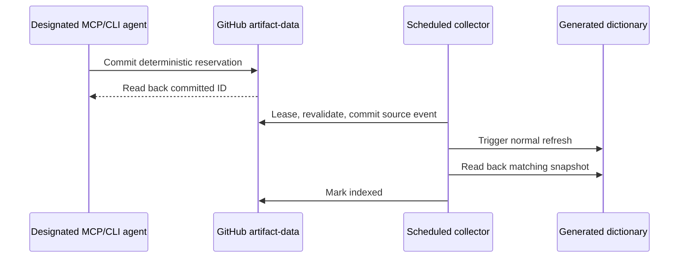

# Issue #84: Git-backed distributed discovery lifecycle

Status: design for review, not deployed. This replaces the separate central API
assumption. PR #101 was closed unmerged because that assumption was wrong.

## System boundary

Global Executables has three GitHub states: `main` holds code and workflows,
`artifact-data` holds durable source observations and collection state, and
`dictionary` holds a generated, queryable snapshot. A designated runner starts
the MCP or CLI agent. That runner already has Git push authority for
`artifact-data`; it does not need an additional hosted service. GitHub Actions
is the periodic collector. Human publisher submissions and Issue forms are out
of scope.

Only the designated, trusted runner may make an automatically reserving query.
A copy of the CLI or MCP server without Git write authority may still verify a
package live, but it must return `reservation.status=unavailable` and must never
promise shared publication. Credentials belong to the runner's Git transport,
not to package metadata, the generated dictionary, or a public MCP response.
No anonymous GitHub write path exists. This permission boundary is explicit;
the client must not embed a reusable repository token.

## The two clocks

An MCP/CLI query of a **known package** fetches current registry metadata and a
bounded release artifact, checks the declared installed command, and returns a
time-stamped result immediately. The current shared dictionary changes only
after a separate scheduled collector rechecks that package, commits evidence to
`artifact-data`, and the normal refresh publishes `dictionary`. A live fact, a
durably reserved item, and an indexed snapshot are different states. An absent
command in the partial dictionary never proves that no public package uses it.

The first live verifiers cover npm `bin` and PyPI wheel `console_scripts`.
crates.io needs its own `[[bin]]` and implicit-binary rules before it can make
verified claims. The [portfolio smoke report](ISSUE_84_PORTFOLIO_SMOKE.md)
shows why Alopex DB's Python package, the separate Alopex CLI crate, and
Skulk's library-only crate must not be conflated. A GitHub release asset such
as Nimino likewise needs a separate checksum and target-aware adapter.

## GitHub state and identity

The reservation queue belongs on `artifact-data`, alongside the existing
on-demand claims and immutable observation events. Use sharded files under
`data/production/on-demand/reservations/<prefix>/<id>.json`, not one shared
JSON document. The deterministic ID hashes ecosystem, canonical package ID,
exact selected release, target variant, and verifier contract version. A file
records the checked time, metadata/artifact digest and URLs, request kind
(`latest` or exact), status, attempt count, retry time, lease, and the source
event/snapshot IDs once known. It stores factual references rather than raw
artifacts. Repeating the same verified release/target produces the same ID and
does not make another queue item; a new release or changed verifier produces
another item. The client observation is **untrusted for publication** even
though the runner is trusted to reserve: the central job independently checks
the authoritative source.

The mutable current provider claim remains keyed by ecosystem and canonical
package. Reservation events are release-specific so an old exact-version query
cannot replace the current claim. The collector records exact old releases as
historical evidence. It promotes an observation into the current dictionary
only if an independent check confirms that the observed release is still the
registry-selected current release at publication time. This is a proposed
policy for review; an all-versions dictionary would require a distinct query
and provider contract.

## Reserving from MCP and CLI

Both interfaces call the same acquisition and Git-reservation library. After
`verified_entry_point`, the runner fetches the latest `artifact-data` head,
creates or reads the deterministic reservation file in an isolated checkout,
commits it, and pushes. It reports a reservation ID only after the push
succeeds and a fresh read confirms the same content. An existing matching
reservation is also an ACK. A failed push, missing permission, or read-back
failure leaves the live verification intact but reports reservation failure.
The Git command must be non-interactive and time-bounded, so a query cannot
hang waiting for a credential prompt.

Concurrent runner agents may reserve the same or different packages. The
writer applies its operation to the newest branch head and retries a bounded
number of non-fast-forward conflicts; it never force-pushes. A deterministic
file and event digest make duplicate delivery safe. Per-package files reduce
contention, while the branch-head retry handles unrelated simultaneous
commits. No client writes directly to `dictionary` or publishes its own
unchecked observation. Because discovery reserves work, its MCP tool must not
carry a read-only annotation; existing snapshot lookup tools remain read-only.

## Periodic collector and commit boundary

A scheduled GitHub Actions job reads due reservations from `artifact-data` in
bounded batches. Its workflow has one concurrency group; a per-item lease with
an expiry also prevents a second runner or a restarted job from treating an
active attempt as free work. Claiming a lease is a Git commit against the latest
head. If the job dies, the item becomes eligible again after expiry. GitHub
Actions schedules can be delayed or skipped, so a later run also scans for
expired leases and stalled publication; the schedule is not a real-time
delivery guarantee.

For each leased item, the collector independently revalidates the registry
release and artifact. In **one `artifact-data` commit**, it records the
source-owned observation/event, updates that package's on-demand projection,
and moves the matching reservation generation to `refresh_pending`. A failed
push causes rebase/reconstruction from the newest head, not blind overwrite.
If revalidation times out, gets 429/5xx, or encounters unverifiable evidence,
the item stays retryable with a reason and next attempt time; no provider is
retired. An authoritative removal/withdrawal creates an explicit tombstone for
the on-demand source and preserves unrelated crawler providers. The collector
also revisits active current claims after a bounded freshness interval even
without new queries, so removed commands can be retired.

The normal refresh restores source observations from `artifact-data`, merges
them with other collectors, validates the canonical records, and publishes
`dictionary`. A `refresh_pending` reservation survives a crash between source
commit and workflow dispatch. Each scheduled collector run reconciles pending
refreshes and may dispatch refresh again idempotently. Only a read-back of the
published dictionary with the matching claim/event digest moves the claim to
`indexed(snapshot)`. A failed refresh remains pending, not indexed. The
existing on-demand source replacement and shrink guard must remain in the
path; omission alone is never a withdrawal event.

State progression is:

`verified_live -> reserved -> leased -> refresh_pending -> indexed(snapshot)`

`leased -> retryable(reason, next_attempt_at) -> leased` handles temporary
failure. An authoritative package/release change records `superseded` or
`withdrawn` without erasing the prior immutable event. Status writes compare
the lease ID and request generation so a late worker cannot overwrite a newer
reservation.

Delivery is at least once. Git commits, immutable event IDs, and package-level
replacement make replay idempotent; no cross-branch transaction is assumed.
Queue health is measured by queued count, oldest due age, expired leases,
retry attempts, and `refresh_pending` age. Keep terminal reservation files for
90 days after indexing or supersession, then prune them in a separate audited
maintenance commit; immutable observation events and Git history remain. Set a
batch limit and alert when queue age grows beyond the collector's expected
capacity rather than claiming that the cron interval guarantees publication.

## Failure and permission cases

| Event | Durable result and recovery |
| --- | --- |
| Two agents reserve the same release | One deterministic item; the losing Git push rereads and acknowledges the winner. |
| Git push succeeds but the client loses the response | Retry reads the matching file and returns the same ID. |
| Runner lacks Git write access or GitHub is unavailable | Live verification may succeed; reservation explicitly fails and no publication is promised. |
| Collector dies after leasing | Lease expires; the next scheduled run retries. |
| Collector commits evidence but refresh dispatch fails | `refresh_pending` remains in Git; the next run dispatches again. |
| Refresh fails or publishes unrelated changes | The claim remains pending until matching dictionary read-back. |
| Old exact-version result arrives after a new current release | Its historical event is retained; it cannot rewind the current claim. |
| Upstream times out versus confirms withdrawal | Timeout keeps prior claim and schedules retry; confirmed withdrawal tombstones only the on-demand claim. |

## Validation before closing #84

1. Test the shared npm/PyPI acquisition fixtures for verified command, library
   only, mismatch, unsupported target, 404/410, 429/5xx, timeout, unsafe URL,
   malformed archive, and cache expiry. MCP and CLI must report the same live
   result and reservation state.
2. Use a local bare Git remote and two independent runner worktrees to test
   same-key deduplication, different-key concurrent pushes, lost ACK, bounded
   conflict retries, no credential prompt, and an unavailable remote.
3. Inject collector crashes before and after the source commit and refresh
   dispatch. Verify lease expiry, idempotent retry, immutable events, current
   claim monotonicity, explicit withdrawal, and unchanged independent
   providers/partial coverage.
4. On the designated runner, verify its Git permissions and branch rules,
   perform a real MCP and CLI reservation, inspect the committed reservation
   on `artifact-data`, run the scheduled collector, and read back the matching
   `dictionary` snapshot. Test a queue outage and a withdrawal. Keep #84 open
   until this path works; passing fixtures alone is insufficient.
5. Repeat live portfolio smoke checks: Alopex DB on PyPI must not invent a
   console script, Alopex CLI and Skulk require the crates adapter before
   reservation, and Global Executables' PyPI commands must be identified from
   the actual wheel. Do not claim crates coverage from an npm/PyPI-only build.

## Review decisions

The proposed current dictionary contains registry-selected current releases;
exact old releases remain historical evidence. The designated runner must have
Git push access to `artifact-data`; an agent without it gets a live answer and
an explicit reservation failure. These are the two policy choices to review
before changing the MCP/CLI implementation. No separate HTTP intake service,
Issue-form submission, or human package report is part of this design.
